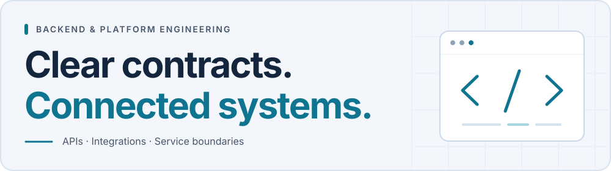

<picture>
  <source media="(prefers-color-scheme: dark)" srcset="assets/profile-banner-dark.svg">
  
</picture>

<h1 align="center">Uttam Kumar</h1>

<strong>Backend &amp; Platform Engineer · Java · Go</strong>

  Bengaluru, India · <a href="#selected-engineering-work">Selected work</a> · <a href="#contact">Contact</a>

I build Java/Spring Boot services and the integrations between systems: REST APIs, authentication, webhooks, and token lifecycles. My current focus is Go, distributed systems, and cloud-native engineering.

---

## Engineering experience

My professional backend work includes:

- **Services and APIs:** Java/Spring Boot development, REST endpoints, and application workflows.
- **Integrations:** third-party APIs, webhook handling, and workflows that connect external services.
- **Identity and access:** authentication, authorization, and token lifecycle handling.

I approach reliability through clear API contracts, explicit failure states, and service boundaries that remain understandable as requirements change.

## Selected engineering work

### [SpeakBetter](https://github.com/uttamkumar37/SpeakBetter)

*Personal application · in development · Java 21, Spring Boot, PostgreSQL, React/TypeScript*

Makes speaking and interview practice repeatable through recorded attempts, self-review, and practice history. The backend separates recording storage from session metadata, uses Flyway migrations, and schedules retention cleanup. Public test source covers upload validation, partial-content playback, and expiry behavior.

[Storage interface](https://github.com/uttamkumar37/SpeakBetter/blob/main/backend/src/main/java/com/speakbetter/practice/service/storage/RecordingStorage.java) · [API and integration tests](https://github.com/uttamkumar37/SpeakBetter/blob/main/backend/src/test/java/com/speakbetter/practice/controller/PracticeSessionIntegrationTest.java)

### [GenAI-Engineering](https://github.com/uttamkumar37/GenAI-Engineering)

*Learning lab · examples and design exercises · Python, Java/Spring AI*

Explores how model-backed features fit into backend systems. Examples cover bounded async concurrency, provider fallback, and circuit breakers. A Java/Python architecture exercise weighs service ownership against the latency and operational cost of another service.

[Provider client example](https://github.com/uttamkumar37/GenAI-Engineering/blob/main/code/01-python-for-ai/03-advanced/llm_provider_abstraction/client.py) · [Java/Python design exercise](https://github.com/uttamkumar37/GenAI-Engineering/blob/main/code/20-java-integration/03-advanced/java-python-hybrid-architecture/ARCHITECTURE.md)

### [System-Design](https://github.com/uttamkumar37/System-Design)

*Study curriculum · documented · distributed systems, databases, messaging*

A structured reference for reasoning from requirements to architecture. The curriculum examines consistency, caching, delivery guarantees, resilience, and observability, with URL-shortener and chat-system study prompts. The focus is making requirements and failure modes explicit before selecting components.

[Read the curriculum](https://github.com/uttamkumar37/System-Design/blob/main/system-design-curriculum.md)

**Also building:** CloudCampus, a multi-tenant school ERP SaaS project being rebuilt backend-first. It is in development, with private source.

## Architecture and engineering decisions

- **Keep storage replaceable.** SpeakBetter's [architecture notes](https://github.com/uttamkumar37/SpeakBetter#architecture-notes) explain local file streaming versus R2 playback through presigned URLs. The storage interface supports both without embedding storage details in the session workflow.
- **Make lifecycle rules testable.** The [retention tests](https://github.com/uttamkumar37/SpeakBetter/blob/main/backend/src/test/java/com/speakbetter/practice/controller/PracticeSessionIntegrationTest.java#L199) check that expired recordings are removed while unexpired recordings remain. Scheduled deletion needs an explicit expiry boundary.
- **Justify a service boundary.** The [Java/Python design exercise](https://github.com/uttamkumar37/GenAI-Engineering/blob/main/code/20-java-integration/03-advanced/java-python-hybrid-architecture/ARCHITECTURE.md) keeps business rules in Java and model-heavy work in Python, while acknowledging that a small feature may be simpler in one process.

## Technical expertise

### Production experience

<picture>
  <source media="(prefers-color-scheme: dark)" srcset="https://skillicons.dev/icons?i=java,spring&amp;theme=dark">
  
</picture>

Java, Spring Boot, REST APIs, third-party integrations, authentication and authorization, webhooks, token lifecycles.

### Hands-on project work

<picture>
  <source media="(prefers-color-scheme: dark)" srcset="https://skillicons.dev/icons?i=postgres,react,ts,python&amp;theme=dark">
  
</picture>

PostgreSQL, Flyway, Spring Data JPA, local/R2 storage adapters, React/TypeScript, Python learning examples, containerized local development.

### Current learning and focus

<picture>
  <source media="(prefers-color-scheme: dark)" srcset="https://skillicons.dev/icons?i=go,kubernetes&amp;theme=dark">
  
</picture>

Go backend services and microservices, Podman, Kubernetes/OpenShift, distributed systems, and platform engineering.

## Technical writing and learning

I keep public study material alongside implementation exercises:

- [Backend-Notes](https://github.com/uttamkumar37/Backend-Notes) — introductory Java/Go practice, backend topics, and language roadmaps.
- [GenAI theory notes](https://github.com/uttamkumar37/GenAI-Engineering/tree/main/theory) — topic-based reading on retrieval, evaluation, reliability, and Java integration.

## GitHub activity

  <a href="https://github.com/uttamkumar37?tab=overview">
    <picture>
      <source media="(prefers-color-scheme: dark)" srcset="https://github-readme-stats.vercel.app/api?username=uttamkumar37&amp;show_icons=true&amp;disable_animations=true&amp;hide_rank=true&amp;hide=stars,issues&amp;theme=github_dark&amp;hide_border=true&amp;custom_title=GitHub%20activity">
      
    </picture>
  </a>

[View contributions directly on GitHub](https://github.com/uttamkumar37?tab=overview).

## Contact

[GitHub](https://github.com/uttamkumar37) · [LinkedIn](https://www.linkedin.com/in/uttamkumar37/) · [Email](mailto:uttamkumar3797@gmail.com)

If you're working on backend integrations, service boundaries, or platform tooling, I'd welcome a technical conversation.
